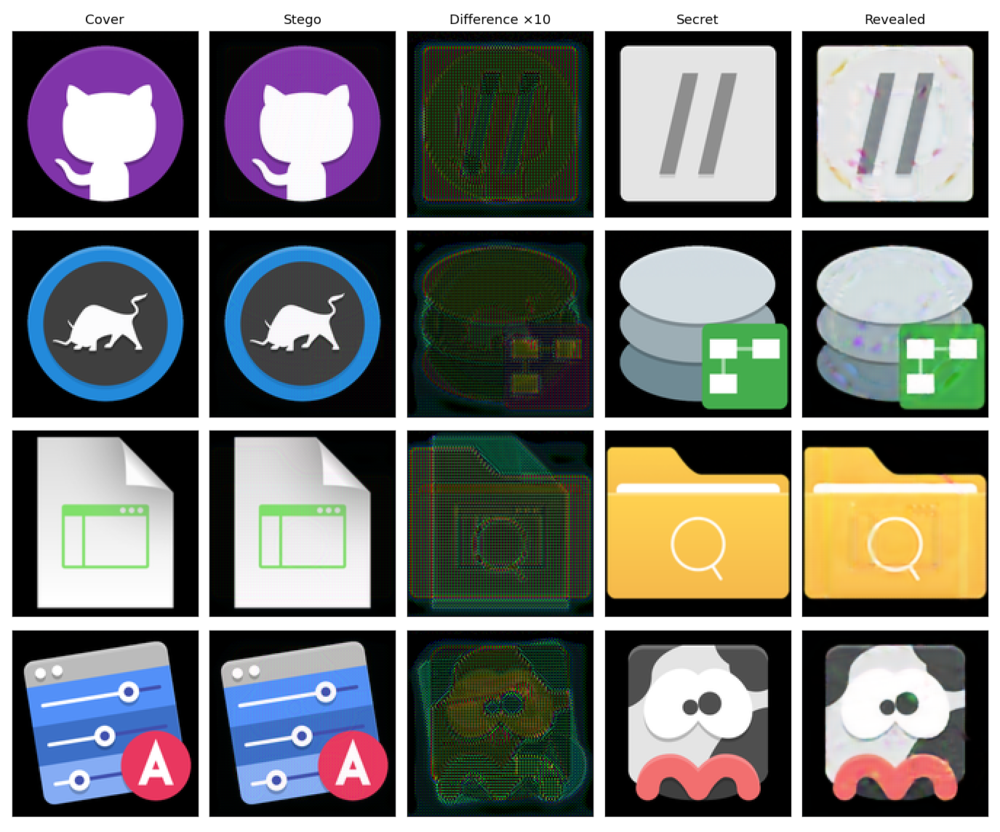
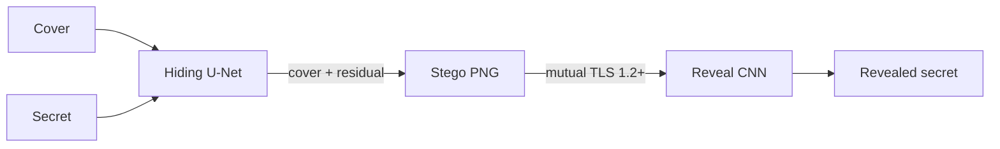

# StegoNet: Deep Image Steganography over Mutual TLS

[](https://github.com/shriniwas2412/stegonet/actions/workflows/ci.yml)


Hide an **entire color image inside another image** with a pair of convolutional neural networks,
then deliver it over a **mutually authenticated TLS channel**. The receiver recovers the secret using
nothing but the stego image.



<sub>Held-out test pairs. Columns: cover · stego (what gets sent) · |stego − cover| × 10 · secret · secret revealed from the stego image alone.</sub>

## Results

| Method (500 held-out pairs, 128×128) | Cover PSNR ↑ | Cover SSIM ↑ | Secret PSNR ↑ | Secret SSIM ↑ |
|---|---:|---:|---:|---:|
| **StegoNet (this project)** | **35.54 dB** | 0.833 | 30.53 dB | **0.895** |
| 4-bit LSB (classical baseline) | 32.18 dB | **0.892** | **32.24 dB** | 0.747 |

All metrics are computed on 8-bit images exactly as they're saved and sent (`python evaluate.py`;
raw numbers in [`results/metrics.json`](results/metrics.json)). Both methods hide a full-size RGB image,
which is **24 bits per pixel**.

**Takeaway:** at the same 24 bpp payload, StegoNet changes the cover less than 4-bit LSB (+3.4 dB PSNR)
and recovers a secret that is structurally closer to the original (SSIM 0.895 vs 0.747). LSB has slightly
higher secret PSNR because it stores exact high-order bits, but it posterizes the secret and is trivially
detectable by bit-plane analysis.

## How it works



- **Hiding network**: a small U-Net (0.47 M parameters) sees the cover and secret and predicts a residual.
  The stego image is `cover + residual`.
- **Reveal network**: a 6-layer CNN (0.15 M parameters) that sees **only the stego image**. It can't cheat by looking
  at the secret, so whatever it recovers was carried in the stego pixels.
- **Trained for the real world**: the stego image is rounded to 8-bit levels during training
  (straight-through gradient), so the decoder works on saved PNGs, not just float tensors.
- **Loss**: `MSE(stego, cover) + 0.75 · MSE(revealed, secret)`, Adam with cosine LR decay.

### Secure transport

| Property | How |
|---|---|
| Only the stego image is transmitted | The sender hides locally; the receiver reveals locally. The cover and secret never touch the network. |
| Confidentiality and integrity in transit | TLS 1.2+ (`ssl` stdlib), forward-secret ECDHE suites |
| Server authentication | Client verifies the server certificate *and* hostname against a private CA |
| Client authentication | Server requires a client certificate (mutual TLS) and rejects anyone else |
| No code execution from the network | Length-prefixed PNG frames with a 32 MB cap, never `pickle` |
| End-to-end check | Receiver returns a SHA-256 of the pixels it got; the sender verifies it |

The test suite checks these properties with real handshakes: a client without a certificate is rejected,
and a server whose certificate comes from a different CA (a man-in-the-middle) is refused.

## Quick start

```bash
git clone https://github.com/shriniwas2412/stegonet.git
cd stegonet
python -m venv venv && source venv/bin/activate
pip install -r requirements.txt
python generate_certificates.py        # private CA + server/client certs in ./certificates
```

**Web app**

```bash
streamlit run app.py
```

**Command line**

```bash
# hide, send over mTLS to a local receiver, reveal and print metrics in one go
python -m stegonet demo --cover assets/samples/cover.png --secret assets/samples/secret.png

# or step by step
python -m stegonet hide   --cover cover.png --secret secret.png --out stego.png
python -m stegonet reveal --stego stego.png --out revealed.png

# across two terminals (or machines: add --host to generate_certificates.py)
python -m stegonet receive --port 5000
python -m stegonet send --stego stego.png --port 5000
```

## Training and evaluation

The model was trained on the [Stego-Images dataset](https://www.kaggle.com/datasets/marcozuppelli/stegoimagesdataset)
(16,000 training images, 256×256 app icons). Put the images in `dataset/train`, `dataset/val` and `dataset/test`, then:

```bash
python train.py --epochs 14 --size 64 --batch-size 32   # ~1.5 h on an Apple M1 (MPS)
python evaluate.py --data dataset/test --pairs 500       # writes results/metrics.json + samples.png
```

The networks are fully convolutional, so a model trained on 64×64 crops runs on images of any size
(sides are cropped to a multiple of 4). Training curves are in
[`results/training_history.json`](results/training_history.json).

## Project layout

```
stegonet/
  models.py      hiding U-Net, reveal CNN, 8-bit straight-through quantization
  pipeline.py    load weights (strict), hide/reveal PIL images
  channel.py     mutual-TLS contexts
  protocol.py    length-prefixed PNG framing with size limits
  transfer.py    sender / receiver
  lsb.py         classical LSB baseline
  metrics.py     PSNR, SSIM, average pixel difference
  __main__.py    command-line interface
app.py                    Streamlit web app
train.py / evaluate.py    training and benchmark scripts
generate_certificates.py  private CA + server/client certificates
tests/                    unit and TLS integration tests (run in GitHub Actions)
weights/stegonet.pt       trained model
```

## Limitations and future work

- **Domain**: trained on app icons. It works on photos but quality drops; retraining on a photo dataset
  such as DIV2K or COCO is the obvious next step.
- **Robustness**: the hidden image doesn't survive JPEG compression, resizing or cropping. Adding
  differentiable JPEG and noise layers during training (as in HiDDeN) would address this.
- **Detectability**: no adversarial steganalysis was done. Training against a steganalysis
  discriminator (e.g. SRNet) would make the stego image harder to detect.
- **Security of the payload**: the secret isn't encrypted before hiding, so anyone with the reveal
  network can extract it. Encrypting the secret first, or keying the networks, would fix that.

## Tests

```bash
pip install -r requirements-dev.txt
pytest -v
```

## Ethics

This project is for education and research in information hiding and network security. Don't use it
to exfiltrate data or communicate without authorization.

## License

[MIT](LICENSE)
